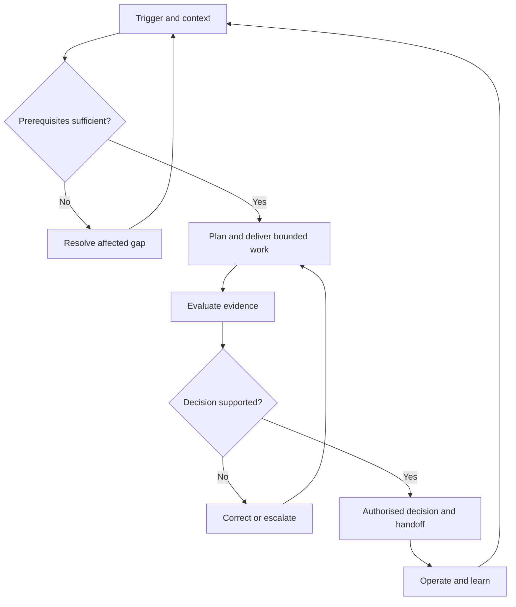

# Shared programme cycle

**Owner:** this file owns the human stage descriptions; the matching structured view is [programme.yaml](../workflows/programme.yaml).

Use the cycle at programme and workstream level. Enter at an incident, renewal, new brief or change; check prerequisites and revisit earlier decisions only where affected. Content and research run from the brief onwards, alongside design and engineering. Sources are selected by the decision, not loaded indiscriminately.

The role labels below are functions for local assignment, not claims that these roles exist. One person may cover several roles. Known serious exclusion invokes immediate recovery and permanent correction in parallel.

## P01 — Establish remit and authority

**Trigger:** New programme, scope change or ownership gap.

**Prerequisites:** Available organisational facts and affected activity.

1. Confirm intended outcomes, entities, service boundaries and existing governance.
2. Involve affected people in framing and name actual decision owners.

**Human owner:** Programme sponsor or delegated owner. **AI support:** Structure intake, identify contradictions and draft charter options.

**Evidence and handoff:** Scope and authority record; Participation and unresolved decision record.

**Exit:** Remit and decision ownership confirmed, or affected decisions explicitly pending. **Next:** P02. **Return:** P01 if its scope or prerequisites need correction.

**Sources:** [S01](../sources/README.md#s01), [S02](../sources/README.md#s02), [S03](../sources/README.md#s03), [S04](../sources/README.md#s04), [S05](../sources/README.md#s05).

## P02 — Map obligations and commitments

**Trigger:** New scope, jurisdiction, contract or policy change.

**Prerequisites:** P01 scoped context; do not guess missing entity or service facts.

1. Route legal, contractual and adopted-policy applicability for competent review.
2. Link requirements to applicable activities and identify unverified claims.

**Human owner:** Competent legal/compliance or policy owner within remit. **AI support:** Retrieve sources and draft applicability, conflict and uncertainty records.

**Evidence and handoff:** Requirement register with authority and versions; Actual reviewer disposition or open question.

**Exit:** Requirements verified for affected decisions; uncertainties remain explicit. **Next:** P03. **Return:** P01 if its scope or prerequisites need correction.

**Sources:** [S02](../sources/README.md#s02), [S03](../sources/README.md#s03), [S08](../sources/README.md#s08), [S09](../sources/README.md#s09), [S10](../sources/README.md#s10).

## P03 — Understand participation and capability

**Trigger:** Baseline needed or unexplained barrier/outcome.

**Prerequisites:** Scoped activities and approved access to available evidence.

1. Map tasks, contexts, dependencies and participation gaps.
2. Combine capability, technical and human evidence without merging their meanings.

**Human owner:** Research/service owner with affected people and relevant specialists. **AI support:** Structure approved findings and suggest research questions and gaps.

**Evidence and handoff:** Baseline with coverage, dates and missingness; Accessible participation plan and influence record.

**Exit:** Enough qualified evidence to propose priorities; remaining unknowns recorded. **Next:** P04. **Return:** P02 if its scope or prerequisites need correction.

**Sources:** [S04](../sources/README.md#s04), [S06](../sources/README.md#s06), [S11](../sources/README.md#s11), [S12](../sources/README.md#s12), [S17](../sources/README.md#s17), [S18](../sources/README.md#s18), [S19](../sources/README.md#s19), [S32](../sources/README.md#s32), [S33](../sources/README.md#s33).

**System assurance:** Inventory accessible UX design and branding systems, foundations, patterns/components, ownership, adoption and assurance gaps. Use the [design/brand system process](../framework/design-and-brand-systems.md) and [assurance plan](../templates/system-assurance-plan.md); retain relevant evidence and open gaps in this handoff.

## P04 — Agree strategy and funded delivery

**Trigger:** Priorities, resources or roadmap require a decision.

**Prerequisites:** Scoped requirements and qualified baseline.

1. Compare interventions across policy, process, services, technology and capability.
2. Agree outcomes, dependencies, resources, measures and accountable owners.

**Human owner:** Sponsor and portfolio owner within confirmed delegation. **AI support:** Compare options, model dependencies and draft a feasible roadmap.

**Evidence and handoff:** Programme plan with confirmed and proposed resources separated; Decision records including consequences of deferral.

**Exit:** Affected work funded and owned; unfunded proposals remain proposals. **Next:** P05. **Return:** P03 if its scope or prerequisites need correction.

**Sources:** [S01](../sources/README.md#s01), [S03](../sources/README.md#s03), [S04](../sources/README.md#s04), [S05](../sources/README.md#s05), [S06](../sources/README.md#s06), [S07](../sources/README.md#s07), [S17](../sources/README.md#s17), [S18](../sources/README.md#s18), [S30](../sources/README.md#s30), [S32](../sources/README.md#s32).

**System assurance:** Plan and resource adoption, creation or remediation of accessible UX and branding systems, with traceable QA and usable brand outcomes. Use the [design/brand system process](../framework/design-and-brand-systems.md) and [assurance plan](../templates/system-assurance-plan.md); retain relevant evidence and open gaps in this handoff.

## P05 — Procure and shape services

**Trigger:** Brief, architecture choice, supplier selection or renewal.

**Prerequisites:** Requirements, delivery owners and relevant permission.

1. Specify task outcomes, acceptance evidence, supplier responsibilities and integration needs.
2. Select specialist modules and plan content, research and evaluation early.

**Human owner:** Service/procurement owner with architecture, design and content leads. **AI support:** Draft briefs, compare supplier evidence and suggest options.

**Evidence and handoff:** Traceable brief and assessment plan; Supplier claims distinguished from locally verified behaviour.

**Exit:** Receiving teams understand requirements, evidence and unresolved commitments. **Next:** P06. **Return:** P04 if its scope or prerequisites need correction.

**Sources:** [S05](../sources/README.md#s05), [S11](../sources/README.md#s11), [S12](../sources/README.md#s12), [S13](../sources/README.md#s13), [S14](../sources/README.md#s14), [S16](../sources/README.md#s16), [S17](../sources/README.md#s17), [S18](../sources/README.md#s18), [S19](../sources/README.md#s19), [S20](../sources/README.md#s20), [S27](../sources/README.md#s27), [S28](../sources/README.md#s28), [S29](../sources/README.md#s29), [S32](../sources/README.md#s32), [S33](../sources/README.md#s33).

**System assurance:** Require system-assurance coverage for every in-scope foundation and pattern/component: guidance, manual/automatable assessment, design requirements, techniques, methodologies, reference implementations and user ACT-style scripts. Use the [design/brand system process](../framework/design-and-brand-systems.md) and [assurance plan](../templates/system-assurance-plan.md); retain relevant evidence and open gaps in this handoff.

## P06 — Design, build and produce

**Trigger:** Approved design, implementation or content work.

**Prerequisites:** Bounded brief, source baseline, owners and execution permissions.

1. Create and review journeys, components, code, content and service procedures.
2. Preserve exact asset versions and handoffs; evaluate early and iterate.

**Human owner:** Delivery lead with responsible engineering, design, editorial and operational owners. **AI support:** Draft code/content, review patterns and prepare candidate fixes in an approved environment.

**Evidence and handoff:** Reviewable versioned assets and requirement links; Handoff, unresolved decisions and review findings.

**Exit:** Implementation and production outputs ready for relevant evaluation. **Next:** P07. **Return:** P05 if its scope or prerequisites need correction.

**Sources:** [S13](../sources/README.md#s13), [S14](../sources/README.md#s14), [S16](../sources/README.md#s16), [S17](../sources/README.md#s17), [S18](../sources/README.md#s18), [S19](../sources/README.md#s19), [S20](../sources/README.md#s20), [S21](../sources/README.md#s21), [S22](../sources/README.md#s22), [S23](../sources/README.md#s23), [S24](../sources/README.md#s24), [S25](../sources/README.md#s25), [S26](../sources/README.md#s26), [S27](../sources/README.md#s27), [S28](../sources/README.md#s28), [S29](../sources/README.md#s29), [S31](../sources/README.md#s31), [S32](../sources/README.md#s32), [S33](../sources/README.md#s33).

**System assurance:** Preserve system-to-implementation-to-test traceability and brand purpose through actual versions, variants and local configurations. Use the [design/brand system process](../framework/design-and-brand-systems.md) and [assurance plan](../templates/system-assurance-plan.md); retain relevant evidence and open gaps in this handoff.

## P07 — Evaluate and correct

**Trigger:** New/changed delivery, failure or retest.

**Prerequisites:** Identified build/assets, methods, environment and authorised evidence access.

1. Combine applicable automated, manual, AT, editorial and task/research evidence.
2. Record actual results and limits; correct and retest failures.

**Human owner:** QA/test owner with specialists, editorial reviewers and research participants. **AI support:** Run supported authorised checks, organise findings and draft remediation options.

**Evidence and handoff:** Raw results, method, environment, coverage and limitations; Remediation/retest records and missing evidence.

**Exit:** Evidence supports a decision or explicitly identifies a block; no silent pass. **Next:** P08. **Return:** P06 if its scope or prerequisites need correction.

**Sources:** [S12](../sources/README.md#s12), [S13](../sources/README.md#s13), [S14](../sources/README.md#s14), [S15](../sources/README.md#s15), [S16](../sources/README.md#s16), [S17](../sources/README.md#s17), [S18](../sources/README.md#s18), [S19](../sources/README.md#s19), [S21](../sources/README.md#s21), [S22](../sources/README.md#s22), [S23](../sources/README.md#s23), [S24](../sources/README.md#s24), [S25](../sources/README.md#s25), [S26](../sources/README.md#s26), [S27](../sources/README.md#s27), [S28](../sources/README.md#s28), [S29](../sources/README.md#s29), [S32](../sources/README.md#s32), [S33](../sources/README.md#s33).

**System assurance:** Check foundation and component coverage, automation limits, user ACT-style outcomes and brand communication; component reuse and a clean scan do not prove usable journeys. Use the [design/brand system process](../framework/design-and-brand-systems.md) and [assurance plan](../templates/system-assurance-plan.md); retain relevant evidence and open gaps in this handoff.

## P08 — Authorise release or transition

**Trigger:** Release, acceptance, procurement or operational transition decision.

**Prerequisites:** Evidence package, open barriers, authority and operational readiness.

1. Review material failures, uncertainty, interim access and correction plans.
2. Record authorised decision, receiving owner, conditions and continuity/rollback.

**Human owner:** Authorised release/service owner; escalate beyond delegation. **AI support:** Assemble evidence, challenge unsupported claims and draft decision options.

**Evidence and handoff:** Authenticated decision reference; Operational handoff and open-issue register.

**Exit:** Decision is recorded within authority; unresolved evidence is not relabelled. **Next:** P09. **Return:** P07 if its scope or prerequisites need correction.

**Sources:** [S01](../sources/README.md#s01), [S02](../sources/README.md#s02), [S08](../sources/README.md#s08), [S09](../sources/README.md#s09), [S10](../sources/README.md#s10), [S11](../sources/README.md#s11), [S12](../sources/README.md#s12), [S13](../sources/README.md#s13), [S14](../sources/README.md#s14), [S17](../sources/README.md#s17), [S32](../sources/README.md#s32).

**System assurance:** Retain unresolved system-assurance, accessible-usability and brand communication gaps in affected release/transition decisions. Use the [design/brand system process](../framework/design-and-brand-systems.md) and [assurance plan](../templates/system-assurance-plan.md); retain relevant evidence and open gaps in this handoff.

## P09 — Operate, report and improve

**Trigger:** Live service, incident, feedback, agreed review or material change.

**Prerequisites:** Operational owner, feedback routes and approved monitoring scope.

1. Respond to barriers and track meaningful resolution.
2. Report evidence and decisions; refresh affected sources and feed learning into normal work.

**Human owner:** Operational/service owner with programme and reporting owners. **AI support:** Analyse authorised signals, route issues, draft reports and flag relevant changes.

**Evidence and handoff:** Outcome reports and owned corrective actions; Source impact assessments and learning decisions.

**Exit:** Actions owned and next review/event route known; operation remains continuous. **Next:** P01. **Return:** P07 if its scope or prerequisites need correction.

**Sources:** [S01](../sources/README.md#s01), [S06](../sources/README.md#s06), [S07](../sources/README.md#s07), [S17](../sources/README.md#s17), [S18](../sources/README.md#s18), [S19](../sources/README.md#s19), [S20](../sources/README.md#s20), [S30](../sources/README.md#s30), [S32](../sources/README.md#s32), [S33](../sources/README.md#s33).

**System assurance:** Trace foundation, token, component, reference implementation and brand-rule changes to affected consumers for regression and outcome review. Use the [design/brand system process](../framework/design-and-brand-systems.md) and [assurance plan](../templates/system-assurance-plan.md); retain relevant evidence and open gaps in this handoff.

## Participation and handoff

At framing, prioritisation, design and evaluation, record whose perspectives influenced the work, what changed, dissent and missing perspectives. Offer accessible ways to contribute. Affected people should not have to rediscover known technical defects.

Each handoff uses the [decision/evidence template](../templates/decision-and-evidence.md): exact scope and asset versions, source-use records, actual findings, unresolved questions, receiving owner and next decision. Completion means the agreed activity is finished; assessment result and approval remain separate.

## Process flow

The flow checks prerequisites, performs bounded work, evaluates it and routes unsupported decisions back for correction. Operation returns new evidence and changes to the relevant stage. A block applies to the affected conclusion, not all independent work.
